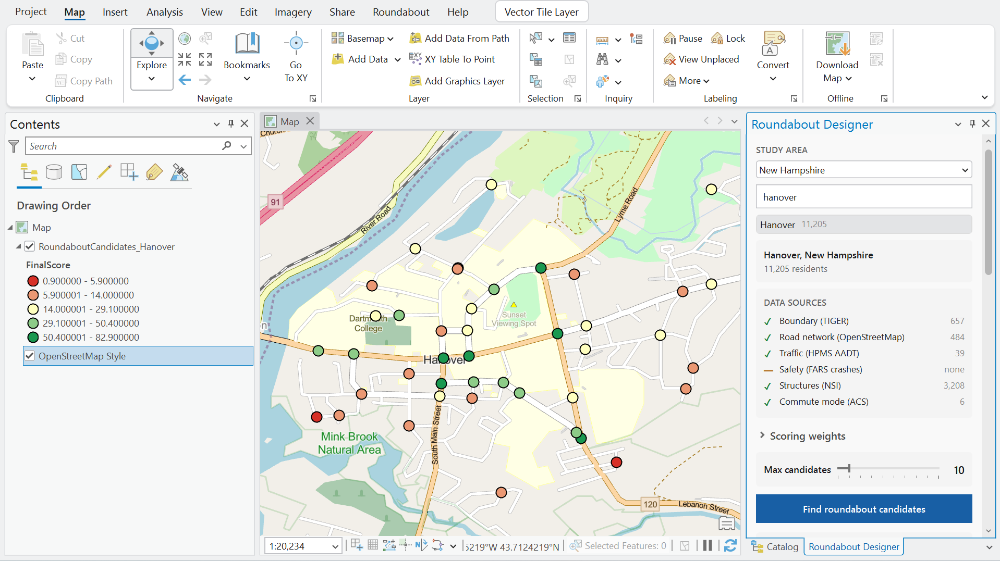
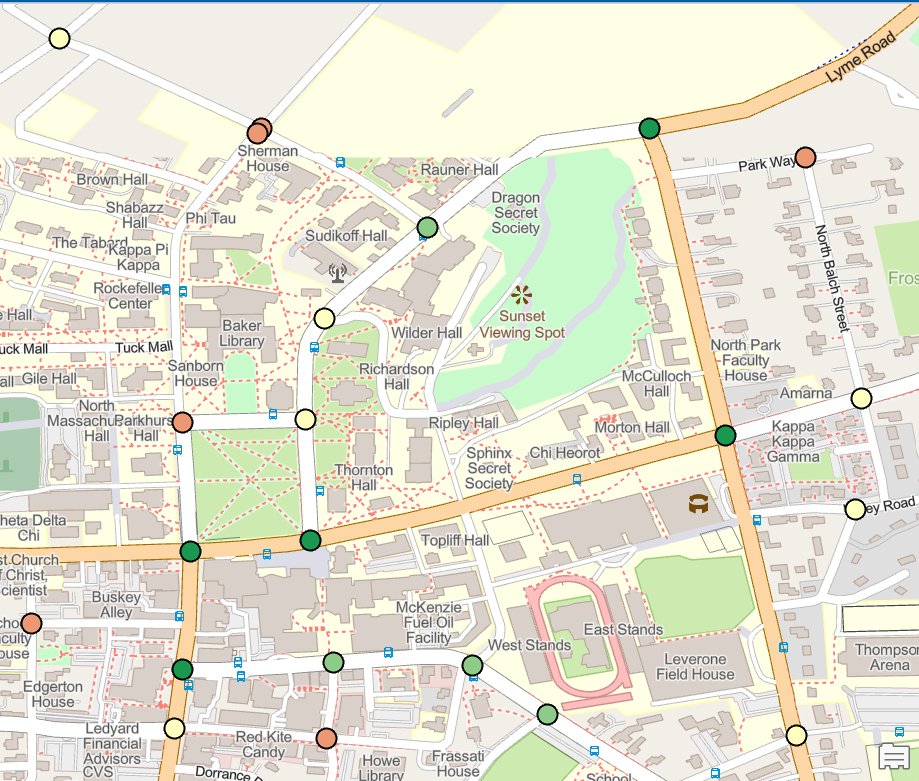
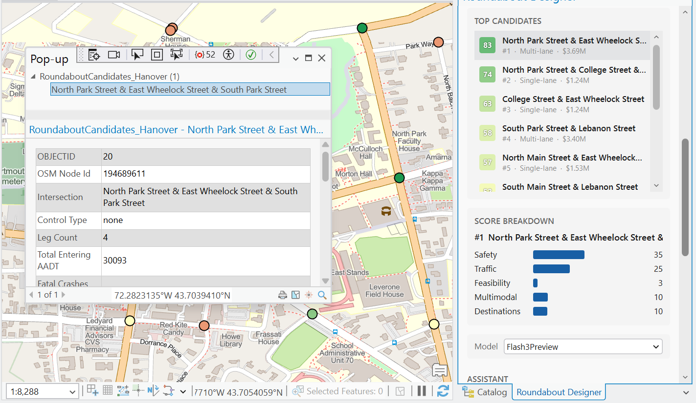
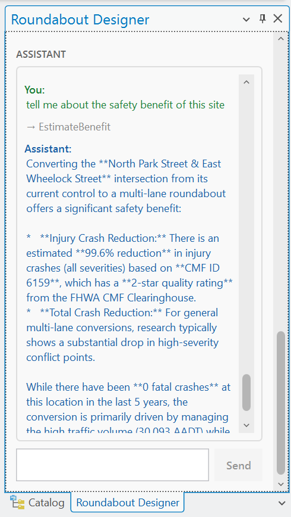
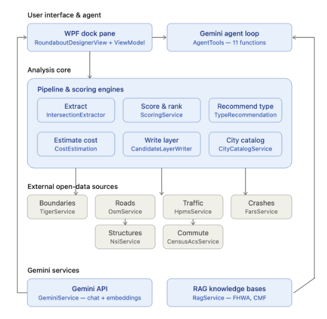

# RoundaboutDesigner

An ArcGIS Pro add-in that screens every intersection in a U.S. city for roundabout conversion potential, ranks the candidates, recommends a roundabout type, estimates planning-level cost, and lets you refine the results by chatting with a Gemini-powered assistant.

Built as the final project for GEOG 58 at Dartmouth College.



## Why

Roundabouts reduce serious crashes, cut idle time, and cost less to maintain than signals, yet they are underused in the U.S. A big reason is that finding good sites is slow: a planner has to pull traffic counts, crash records, right-of-way, and land use for each intersection and apply engineering judgment one site at a time. RoundaboutDesigner automates that first-pass screening so engineering staff can spend their time on the sites most likely to pay off.

## What it does

1. **Pick a study area.** Search any U.S. city or town; boundaries come from Census TIGERweb.
2. **Pull open data automatically.** Road network and intersections (OpenStreetMap / Overpass), traffic volumes (FHWA HPMS), fatal crashes (NHTSA FARS), structures and value (USACE National Structure Inventory), and commute mode share (Census ACS). The pane shows live status for each source.
3. **Score every intersection** on five weighted criteria (Safety, Traffic, Feasibility, Multimodal, Destinations), normalized within the study area to a 0 to 100 score. Weights are adjustable with sliders.
4. **Recommend a type** (mini, single-lane, or multi-lane) from entering volume, posted speed, and leg balance, following FHWA planning guidance.
5. **Estimate cost** from footprint, lane count, utility relocation per leg, right-of-way acquisition, and a 30% contingency.
6. **Write a candidate feature class** to the project geodatabase, symbolized by score, with attributes for type, cost, safety benefit, and score breakdown.
7. **Chat to refine.** The assistant uses Gemini function calling to filter, sort, re-weight, zoom to, and explain candidates, and grounds its answers in the FHWA *Roundabouts: An Informational Guide* and CMF Clearinghouse data through retrieval-augmented generation (RAG).

| Candidates on the map | Top candidates and score breakdown | Assistant |
|---|---|---|
|  |  |  |

### Assistant tools

`GetCurrentState`, `RunFullAnalysis`, `FilterResults`, `SortCandidates`, `AdjustWeights`, `GetCandidateDetails`, `SummarizeResults`, `ZoomToCandidate`, `ExplainScore`, `ExplainRecommendation`, `EstimateBenefit`

Example prompts:

- "Only show candidates under $2M"
- "Prioritize sites near schools"
- "Why is #1 ranked first?"
- "Zoom to candidate 3 and explain the recommended type"

## Architecture



```
RoundaboutDesigner/
├── Config/            AppConfig + ApiKeys.example.json (copy to ApiKeys.json)
├── Gemini/            Gemini REST client (chat, function calling, embeddings)
├── Knowledgebase/     Prebuilt RAG embeddings (FHWA guide, CMF), U.S. city catalog
│   └── Sources/       Plain-text sources the knowledge bases were built from
├── Models/            Candidate, recommendation, cost, scoring-weight types
├── Services/          Data acquisition, scoring, type rec, cost, RAG, agent tools, layer writer
├── UI/                WPF dock pane (view + view model)
└── Config.daml        Add-in ribbon tab, button, and dock pane
```

## Requirements

- Windows 10/11
- ArcGIS Pro **3.6** (built against 3.6.2) with a license
- Visual Studio 2022 with the **ArcGIS Pro SDK for .NET** extension and the .NET 8 SDK
- A [Gemini API key](https://aistudio.google.com/apikey)
- A [Census API key](https://api.census.gov/data/key_signup.html)
- NHTSA FARS accident CSVs (see below)

> ArcGIS Pro releases newer than 3.6 may run on a newer .NET. If the build fails with a framework mismatch, either install Pro 3.6.x or retarget the project to the matching `netX.0-windows` framework.

## Setup

1. **Clone**
   ```
   git clone https://github.com/23garyd/RoundaboutDesigner.git
   ```
2. **Download FARS data.** From the [NHTSA FARS data page](https://www.nhtsa.gov/file-downloads?p=nhtsa/downloads/FARS/), download the national CSV zip for each year you want (the project used 2020 to 2024). Extract each year's `accident.csv`, rename it `accident_YYYY.csv`, and put them in a `FARS/` folder. These files are about 25 MB each and are not in the repo.
3. **Add your keys.** Copy `RoundaboutDesigner/Config/ApiKeys.example.json` to `RoundaboutDesigner/Config/ApiKeys.json` and fill in `GeminiApiKey`, `CensusApiKey`, and `FarsDataFolder` (the full path to your `FARS/` folder). `ApiKeys.json` is gitignored.
4. **Build.** Open `RoundaboutDesigner.sln` in Visual Studio and build. The build packages and registers the `.esriAddinX`.
5. **Run.** Start ArcGIS Pro (F5 in Visual Studio launches it), open any project, go to the **Roundabout** tab, and click **Roundabout Designer**.

## Usage

1. Search for a city in **Study Area** and select it.
2. Optionally adjust the **Scoring weights** and **Max candidates**.
3. Click **Find roundabout candidates**. Watch **Data Sources** as each feed loads.
4. Review **Top Candidates** and the **Score Breakdown**; the candidate layer is added to the active map.
5. Ask the **Assistant** to filter, re-rank, or explain results.

## Limitations

- This is a **planning-level screening tool**, not an engineering design or cost estimate.
- Scores are normalized within each study area, so they compare sites within one run but not across cities.
- FARS covers fatal crashes only; injury and property-damage crashes are not included.
- HPMS volume coverage is sparse on local roads, which can understate traffic for minor intersections.
- Unit costs are fixed national planning constants in `CostEstimationService.cs`.

## Data sources and acknowledgments

- U.S. Census Bureau: TIGERweb, American Community Survey
- OpenStreetMap contributors (ODbL) via the Overpass API
- FHWA Highway Performance Monitoring System (HPMS)
- NHTSA Fatality Analysis Reporting System (FARS)
- USACE National Structure Inventory (NSI)
- FHWA, *Roundabouts: An Informational Guide*
- CMF Clearinghouse
- Google Gemini API

## Author

Gary Ding, Dartmouth College, GEOG 58
